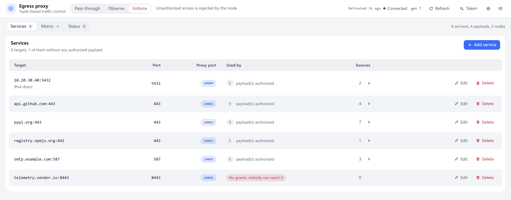
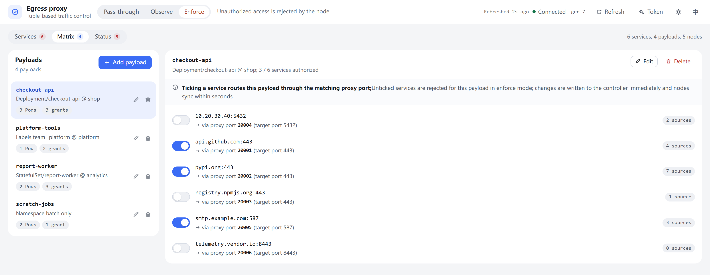
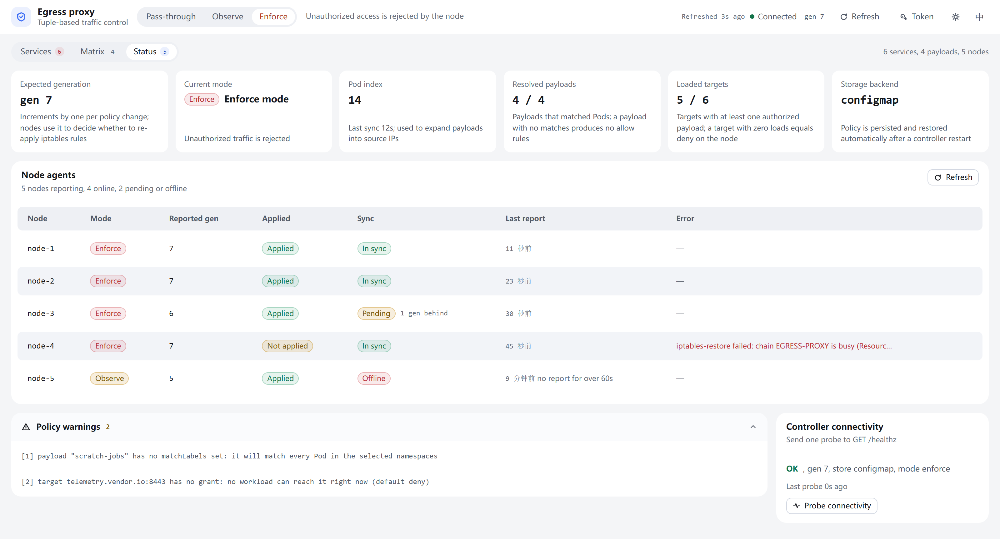

**English** | [中文](README.md)

# Directed egress proxy for Kubernetes external services

Route TCP traffic from Pods to **specific external targets** (domain name or IPv4 + port) so that it all goes out through one designated node:
the DaemonSet on each worker node performs DNAT in a dedicated iptables chain, traffic is sent to the proxy node, and `tcp-forwarder`
on the proxy node then forwards it by port to the **original target**.

- **Zero changes to applications**: Pods keep using the original domain / port; redirection happens in the node's nat table, so applications never need to know a proxy exists
- **Only our own chain is touched**: every rule is added to and removed from the dedicated `EGRESS-PROXY` chain, no other iptables rules on the node are modified, and everything is cleaned up when the process exits
- **Only two places to configure**: runtime config `deploy/config.yaml` and image addresses `deploy/kustomization.yaml`; a single `kubectl apply -k deploy/` takes effect, with no Pod restart
- **Optional 4-tuple enforcement**: upgrade access control into an authorization matrix of "payload (source) + target + target port + proxy port"; unauthorized payloads are rejected outright, with a built-in WebUI

> Only **IPv4 + TCP** is supported; the proxy node is a **single point**.
> Image names in this document are written uniformly as `<registry>/egress-proxy/redirect-agent:0.1.6`;
> **replace `<registry>` with your own image registry address** (for example `harbor.example.com`).

## Built-in WebUI

Once 4-tuple enforcement is enabled, the controller ships with a WebUI (default port `18082`), so no separate dashboard has to be deployed:

- **External services**: maintain `host` / `port` / `proxyPort`, and see the source address currently in effect for each service
- **Authorization matrix**: pick a workload on the left, tick the external services it may reach on the right; ticks take effect immediately with no save step; targets that are not authorized are unreachable for everyone
- **Runtime status**: switch enforcement mode (`disabled` / `observe` / `enforce`), and inspect each node agent's apply and sync status plus controller connectivity

```bash
kubectl -n egress-proxy port-forward svc/egress-proxy-controller 18082:18082
# then open http://localhost:18082 in your browser
```

The UI follows the browser language (Chinese or English) and the theme follows the system light / dark setting by default;
both can be switched at any time from the top-right of the header. Because it can change egress policy directly, inject an access token before using it in production
(see "Security: adding a token to the WebUI" in [deploy/README.en.md](deploy/README.en.md)).

### A look at the UI

One screenshot per tab (taken from the `internal/controller/assets/index.html` bundled in this repository; only the data is demo data):

**External services**: one row per `host:port` target, with its target port, proxy port, how many payloads are authorized to use it, and how many source addresses are currently in effect (click to expand the IP list). Targets nobody is authorized for are flagged in red; "Add service" in the top right maintains this layer.



**Authorization matrix**: the left column lists payloads (with the number of matched Pods and existing grants), the right column holds one switch per external service for the selected payload, showing which proxy port it goes through and how many source addresses are live. A tick is written to the controller immediately; there is no save button.



**Runtime status**: the first row shows generation, current mode, the Pod index, resolved payloads, armed targets and the storage backend; the middle table shows each node agent's reported generation, apply / sync state and error; the bottom holds the raw policy warnings and a controller connectivity probe.



## Architecture

```
Worker node A (has Pods that need to reach external targets)
  Pod (business container)
    │  TCP connect a.example.com:443
    ▼
  DNS resolve → 10.20.30.40 / ... (refreshed periodically by options.resolveInterval)
    │
    ▼
  built-in chains in the nat table (PREROUTING / OUTPUT)
    │  agent attaches one jump to the dedicated chain here
    ▼
  dedicated chain EGRESS-PROXY
    -d 10.20.30.40 -p tcp --dport 443 -j DNAT --to-destination <proxy node>:20001
    (agent only adds/removes rules inside this chain, other chains are untouched)
    │
    │  TCP traffic after DNAT (cross-node, destination port = proxyPort)
    ▼
Proxy node (label: egress-proxy=true, hostNetwork)
  Deployment egress-proxy-tcp-forwarder
    listen 0.0.0.0:20001 ──► dial a.example.com:443
    listen 0.0.0.0:20002 ──► dial b.example.com:443
    listen 0.0.0.0:20003 ──► dial b.example.com:8443
    ... (one proxyPort per target)
    /healthz, /readyz ← 0.0.0.0:18081 (options.healthPort)
    │
    ▼
External targets (a.example.com:443 / 10.20.30.40:5432 / ...)
```

The traffic path in one sentence: **Pod → the dedicated chain EGRESS-PROXY in the local node's nat table → tcp-forwarder on the proxy node → external target**

## Component responsibilities

| Component | Type | Where it runs | Responsibility |
| --- | --- | --- | --- |
| `egress-proxy-config` | ConfigMap (generated by kustomization from `deploy/config.yaml`) | namespace `egress-proxy` | Single source of configuration (key `config.yaml`), mounted read-only at `/etc/egress-proxy` in both workloads; changes are hot-reloaded by both components automatically |
| `redirect-agent` | DaemonSet `egress-proxy-redirect-agent` | every worker node, `hostNetwork` | Polls configuration, resolves target domains to IPv4, maintains DNAT rules in the nat table's dedicated chain `EGRESS-PROXY` (`options.chainName`); periodically self-checks and repairs drift; removes rules and the chain on exit |
| `tcp-forwarder` | Deployment `egress-proxy-tcp-forwarder` (replicas:1) | proxy node (`nodeSelector: egress-proxy=true`), `hostNetwork` | Listens on each `proxyPort` and forwards connections to the original `host:port`; serves `/healthz` and `/readyz` |
| `egress-proxy-controller` | Deployment `egress-proxy-controller` (replicas:1) + Service | any node in the cluster (hostNetwork not required) | Control plane for 4-tuple policy: stores policies, resolves Pods, compiles "allowed sources per target" per node, and serves the REST API and built-in WebUI (`:18082`); enabled only when `options.policyUrl` points at it |

All three take the same startup flags: `-config` (default `/etc/egress-proxy/config.yaml`) and
`-log-level` (default `info`; one of `debug`/`info`/`warn`/`error`),
and read their node IP from the `HOST_IP` environment variable (Downward API `status.hostIP`).

## Quick start

Prerequisites: `kubectl` can reach the target cluster; the proxy node has been chosen (it must be a worker node with a stable IP);
the images are built and pullable by the cluster (alternatively, import a tar archive onto the node first — see the link below).

```bash
# 1) build and push the images (see "Image preparation" in deploy/README.en.md)
docker build -f Dockerfile.agent -t <registry>/egress-proxy/redirect-agent:0.1.6 .
docker build -f Dockerfile.proxy -t <registry>/egress-proxy/tcp-forwarder:0.1.6 .
docker build -f Dockerfile.controller -t <registry>/egress-proxy/controller:0.1.6 .
docker push <registry>/egress-proxy/redirect-agent:0.1.6
docker push <registry>/egress-proxy/tcp-forwarder:0.1.6
docker push <registry>/egress-proxy/controller:0.1.6

# 2) label the chosen proxy node (must be a worker node with a stable IP)
kubectl label node <node> egress-proxy=true

# 3) edit the runtime config: set proxy.address to the proxy node IP, add/remove targets as needed
$EDITOR deploy/config.yaml                # proxy.address / targets / proxyPort

# 4) apply with a single command (image addresses live only in deploy/kustomization.yaml)
kubectl apply -k deploy/
kubectl -n egress-proxy get ds,deploy,pod -o wide

# 5) optional: open the WebUI once 4-tuple enforcement is enabled (see "4-tuple traffic enforcement" in deploy/README.en.md)
kubectl -n egress-proxy port-forward svc/egress-proxy-controller 18082:18082
```

Order matters: **label the node first, then set `proxy.address`, and apply last**; otherwise `tcp-forwarder` may stay
Pending forever because `nodeSelector` matches no node, or DNAT may point at an IP with nothing listening.

Minimal working `deploy/config.yaml`:

```yaml
proxy:
  address: 10.0.0.12          # proxy node IP
targets:
  - host: a.example.com
    port: 443
    proxyPort: 20001
```

## Deployment guide

Pre-deployment checks (port planning, firewall / NetworkPolicy, iptables backend consistency), image preparation and offline packaging,
the full configuration field table, 4-tuple enforcement and the WebUI, the go-live acceptance checklist, day-2 operations, rollback and uninstall,
known limitations and troubleshooting:
see **[deploy/README.en.md](deploy/README.en.md)**.

## Directory layout

```text
cmd/             entry points of the three binaries: redirect-agent / tcp-forwarder / controller
internal/        implementation: agent, forward, policy, resolver, rules, iptables, controller, logging, deploycheck
config/          config file parsing and validation (including defaults)
deploy/          deployment manifests and runtime config: Kustomize entry point, base manifests, image tarballs → deployment guide in deploy/README.en.md
scripts/         local end-to-end smoke script, image packaging script
Dockerfile.*     build recipes for the three images (multi-stage build, statically compiled)
```

## Development

```bash
go build ./... && go vet ./... && go test ./...   # unit tests, no cluster needed
bash scripts/smoke-local.sh                      # local end-to-end smoke test (Linux; the iptables part needs root)
```

Dependencies are fetched through `GOPROXY` according to `go.sum` (the repository does not include `vendor/`), so the first build needs access to a module proxy.
The tests in `internal/deploycheck` verify that the kustomization, the base manifests and the runtime config under `deploy/` are consistent
(placeholder image names, ConfigMap name / key / namespace, probe ports, and so on), so run `go test ./...` after changing any manifest.

The WebUI is a self-contained single file, `internal/controller/assets/index.html`: the Chinese and English
strings live in the `EN` dictionary inside that file (keyed by the Chinese source text, with `EN_RULES`
regexes for sentences that embed numbers), and language / theme auto-detection happens in the first-paint
`<head>` script, so there is no build step. To add a string, add one dictionary entry for `T()`; anything
untranslated falls back to Chinese.

API messages are bilingual as well: the controller renders validation errors and warnings according to the
`Accept-Language` request header (Chinese by default), and the WebUI sends that header together with the current UI language.
Process-level text (logs, `-h` help, config-file parsing errors) follows `-lang zh|en` or the `EGRESS_LANG`
environment variable, Chinese by default; errors reported by nodes carry both languages, so the WebUI and the API
render them in the language of the request.

## Known limitations (summary)

- **IPv4 + TCP only**, and the proxy node is a **single point** (if it fails, all proxied traffic is interrupted)
- **The 4-tuple "default deny" only applies along the registered target dimension**; it is not a Pod-level firewall. To enforce "a given class of Pods may only reach a whitelist", use NetworkPolicy
- **Authorization granularity is IP + port**: with GeoDNS / multiple A records, a Pod may connect to an IP that no rule covers yet
- **Bypassable**: connecting directly to `proxy node IP:proxyPort` skips payload evaluation

For the full list (covering the kube-proxy legacy backend, hostNetwork Pods, the Pod IP reuse window, conntrack taking precedence over policy changes, and other details),
see "Known limitations" in [deploy/README.en.md](deploy/README.en.md).
