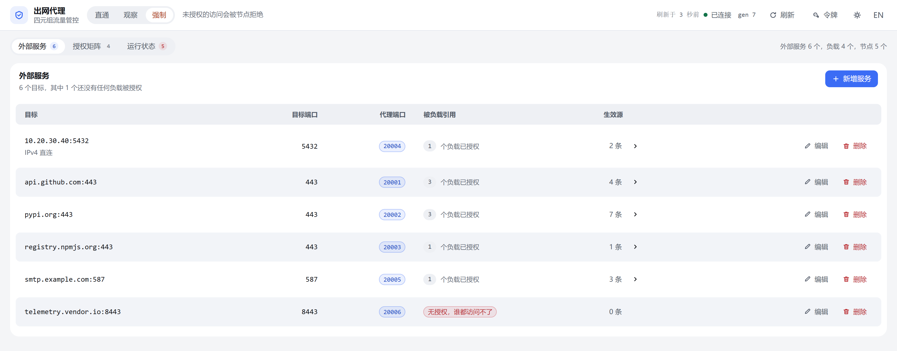
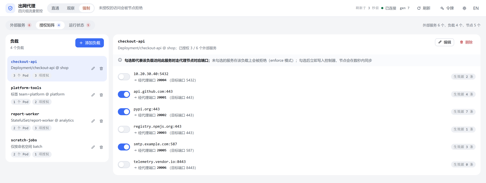
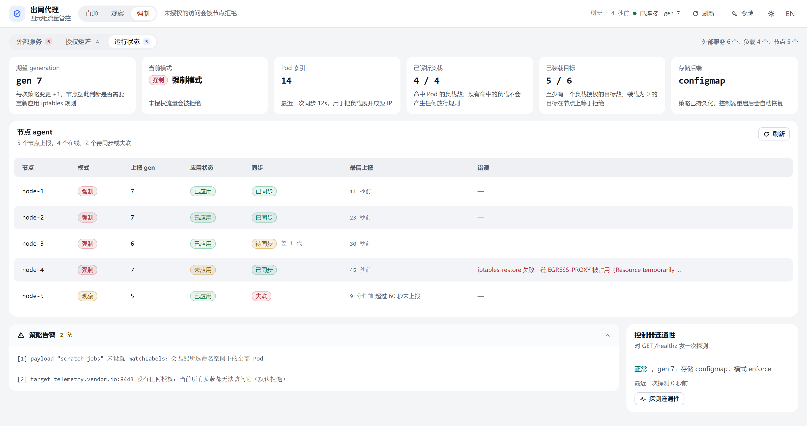

**中文** | [English](README.en.md)

# Kubernetes 外部服务的定向代理

把集群内 Pod 访问**指定外部目标**（域名或 IPv4 + 端口）的 TCP 流量，统一从一台指定节点绕行出去：
工作节点上的 DaemonSet 用 iptables 在专属链里做 DNAT，流量被送到代理节点，代理节点上的
`tcp-forwarder` 再按端口转发到**原始目标**。

- **业务零改动**：Pod 仍访问原域名 / 原端口，重定向发生在节点 nat 表，业务无需感知代理的存在
- **只动自己的链**：所有规则都在专属链 `EGRESS-PROXY` 里增删，不触碰节点上其他 iptables 规则，进程退出时自动清理
- **配置只写两处**：运行配置 `deploy/config.yaml`、镜像地址 `deploy/kustomization.yaml`；一条 `kubectl apply -k deploy/` 生效，Pod 无需重启
- **可选的四元组管控**：把访问策略升级成「payload（源）+ 目标 + 目标端口 + 代理端口」的授权矩阵，未授权的 payload 直接拒绝，自带 WebUI

> 仅支持 **IPv4 + TCP**；代理节点是**单点**。
> 文档中的镜像名统一写作 `<registry>/egress-proxy/redirect-agent:0.1.6` 的形式，
> **请把 `<registry>` 替换成你自己的镜像仓库地址**（例如 `harbor.example.com`）。

## 内置 WebUI

启用四元组管控后，控制器自带一个 WebUI（默认端口 `18082`），不需要另外部署面板：

- **外部服务**：维护 `host` / `port` / `proxyPort`，并显示每个服务当前实际生效的源地址
- **授权矩阵**：左边选负载、右边勾选它能访问的外部服务，勾选即刻生效、无需保存；没有授权的目标谁都不通
- **运行状态**：切换执行模式（`disabled` / `observe` / `enforce`），查看各节点 agent 的应用与同步状态、控制器连通性

```bash
kubectl -n egress-proxy port-forward svc/egress-proxy-controller 18082:18082
# 然后浏览器打开 http://localhost:18082
```

界面默认按浏览器语言显示中文或英文，主题默认跟随系统深浅色，顶栏右侧可随时切换。
因为它能直接改出网策略，生产环境请先注入访问令牌
（见 [deploy/README.md](deploy/README.md) 的「安全：给 WebUI 加令牌」）。

### 界面速览

下面三张图分别对应三个标签页（截图来自本仓库内置的 `internal/controller/assets/index.html`，仅数据为演示数据）：

**外部服务**：一行一个目标 `host:port`，旁边是目标端口、代理端口、被多少个负载授权引用，以及当前实际生效的源地址条数（点开可展开成 IP 列表）。没有授权引用的目标会标红，右上角「新增服务」维护这一层。



**授权矩阵**：左栏是负载（显示匹配到的 Pod 数与已有授权数），右栏是该负载对每个外部服务的开关，开关下面写着走哪个代理端口、当前有多少条生效源。勾选即时写入控制器，没有保存按钮。



**运行状态**：第一行是 generation、当前模式、Pod 索引、已解析负载、已装载目标与存储后端；中间是各节点 agent 的上报 generation、应用/同步状态与错误；底部是策略告警原文和控制器连通性探测结果。



## 架构

```
工作节点 A（有 Pod 要访问外部目标）
  Pod（业务容器）
    │  TCP connect a.example.com:443
    ▼
  DNS 解析 → 10.20.30.40 / ...（由 options.resolveInterval 周期刷新）
    │
    ▼
  nat 表内置链（PREROUTING / OUTPUT）
    │  agent 在这里挂一条 jump 到专属链
    ▼
  专属链 EGRESS-PROXY
    -d 10.20.30.40 -p tcp --dport 443 -j DNAT --to-destination <代理节点>:20001
    （agent 只在本链内增删规则，不动其他链）
    │
    │  被 DNAT 后的 TCP 流量（跨节点，目标端口 = proxyPort）
    ▼
代理节点（label: egress-proxy=true，hostNetwork）
  Deployment egress-proxy-tcp-forwarder
    监听 0.0.0.0:20001 ──► dial a.example.com:443
    监听 0.0.0.0:20002 ──► dial b.example.com:443
    监听 0.0.0.0:20003 ──► dial b.example.com:8443
    ...（每个 target 一个 proxyPort）
    /healthz、/readyz ← 0.0.0.0:18081（options.healthPort）
    │
    ▼
外部目标（a.example.com:443 / 10.20.30.40:5432 / ...）
```

流量路径一句话概括：**Pod → 本节点 nat 表专属链 EGRESS-PROXY → 代理节点 tcp-forwarder → 外部目标**

## 组件职责

| 组件 | 类型 | 运行位置 | 职责 |
| --- | --- | --- | --- |
| `egress-proxy-config` | ConfigMap（由 kustomization 从 `deploy/config.yaml` 生成） | namespace `egress-proxy` | 唯一配置来源（key `config.yaml`），挂载到两个工作负载的 `/etc/egress-proxy`（只读），改动后两个组件自动热加载 |
| `redirect-agent` | DaemonSet `egress-proxy-redirect-agent` | 每个工作节点，`hostNetwork` | 轮询配置、解析目标域名 IPv4，在 nat 表专属链 `EGRESS-PROXY`（`options.chainName`）内维护 DNAT 规则；定期自检并修复漂移；退出时清理规则与链 |
| `tcp-forwarder` | Deployment `egress-proxy-tcp-forwarder`（replicas:1） | 代理节点（`nodeSelector: egress-proxy=true`），`hostNetwork` | 按 `proxyPort` 监听，把连接转发到原始 `host:port`；提供 `/healthz`、`/readyz` |
| `egress-proxy-controller` | Deployment `egress-proxy-controller`（replicas:1）+ Service | 集群内任意节点（不需要 hostNetwork） | 四元组策略的控制面：保存策略、解析 Pod、按节点编译「每个目标的允许源」，提供 REST API 与内置 WebUI（`:18082`）；仅当 `options.policyUrl` 指向它时启用 |

三者启动参数一致：`-config`（默认 `/etc/egress-proxy/config.yaml`）、
`-log-level`（默认 `info`，可选 `debug`/`info`/`warn`/`error`），
并从环境变量 `HOST_IP`（Downward API `status.hostIP`）获取本节点 IP。

## 快速开始

前置：`kubectl` 可访问目标集群；代理节点已选定（必须是工作节点，IP 稳定）；
镜像已构建并可被集群拉取（也可以先用 tar 包导入节点，见下方链接）。

```bash
# 1) 构建并推送镜像（详见 deploy/README.md「镜像准备」）
docker build -f Dockerfile.agent -t <registry>/egress-proxy/redirect-agent:0.1.6 .
docker build -f Dockerfile.proxy -t <registry>/egress-proxy/tcp-forwarder:0.1.6 .
docker build -f Dockerfile.controller -t <registry>/egress-proxy/controller:0.1.6 .
docker push <registry>/egress-proxy/redirect-agent:0.1.6
docker push <registry>/egress-proxy/tcp-forwarder:0.1.6
docker push <registry>/egress-proxy/controller:0.1.6

# 2) 给选定的代理节点打标签（必须是工作节点，且 IP 稳定）
kubectl label node <node> egress-proxy=true

# 3) 改运行配置：proxy.address 填该代理节点 IP，并按需增删 targets
$EDITOR deploy/config.yaml                # proxy.address / targets / proxyPort

# 4) 一条命令应用（镜像地址只改 deploy/kustomization.yaml 一处）
kubectl apply -k deploy/
kubectl -n egress-proxy get ds,deploy,pod -o wide

# 5) 可选：启用四元组管控后打开 WebUI（详见 deploy/README.md「四元组流量管控」）
kubectl -n egress-proxy port-forward svc/egress-proxy-controller 18082:18082
```

顺序很重要：**先打标签、再改 `proxy.address`、最后 apply**；否则 `tcp-forwarder` 可能因为
`nodeSelector` 找不到节点而一直 Pending，或 DNAT 指向一个没有监听服务的 IP。

最小可用的 `deploy/config.yaml`：

```yaml
proxy:
  address: 10.0.0.12          # 代理节点 IP
targets:
  - host: a.example.com
    port: 443
    proxyPort: 20001
```

## 部署文档

部署前检查（端口规划、防火墙 / NetworkPolicy、iptables 后端一致性）、镜像准备与离线打包、
配置字段全表、四元组管控与 WebUI、上线验收清单、日常运维、回滚与卸载、已知限制与故障排查，
见 **[deploy/README.md](deploy/README.md)**。

## 目录结构

```text
cmd/             三个可执行文件入口：redirect-agent / tcp-forwarder / controller
internal/        实现：agent、forward、policy、resolver、rules、iptables、controller、logging、deploycheck
config/          配置文件解析与校验（含默认值）
deploy/          部署清单与运行配置：Kustomize 入口、base 清单、镜像 tar 包 → 部署文档见 deploy/README.md
scripts/         本地端到端冒烟脚本、镜像打包脚本
Dockerfile.*     三个镜像的构建脚本（多阶段构建、静态编译）
```

## 开发

```bash
go build ./... && go vet ./... && go test ./...   # 单元测试，不需要集群
bash scripts/smoke-local.sh                      # 本机端到端冒烟（Linux；iptables 部分需要 root）
```

依赖按 `go.sum` 通过 `GOPROXY` 拉取（仓库不含 `vendor/`），首次构建需要能访问模块代理。
`internal/deploycheck` 里的测试会校验 `deploy/` 下的 kustomization、base 清单与运行配置三者一致
（占位镜像名、ConfigMap 名称 / key / 命名空间、探针端口等），改清单后请一并跑 `go test ./...`。

WebUI 是自包含的单文件 `internal/controller/assets/index.html`：中英文文案集中在该文件的 `EN` 词典里
（以中文原文为 key，含数字的动态句由 `EN_RULES` 正则处理），语言与主题的自动检测在 `<head>` 的首帧脚本里，
因此没有构建步骤；新增文案时给 `T()` 补一条词典项即可，漏译会原样回退中文。

面向 API 的文案同样是双语的：控制器按请求头 `Accept-Language` 返回校验错误与告警（缺省中文），
WebUI 会随当前界面语言自动带上该请求头。
进程级文案（日志、`-h` 帮助、配置文件解析错误）由 `-lang zh|en` 或环境变量 `EGRESS_LANG` 决定，缺省中文；
节点上报的错误同时携带中英两种文本，WebUI 与 API 按界面/请求语言显示。

## 已知限制（摘要）

- **仅支持 IPv4 + TCP**，且代理节点是**单点**（该节点故障会导致被代理流量中断）
- **四元组的「默认拒绝」只在已登记的 target 维度生效**，不是 Pod 维度的防火墙；要「某类 Pod 只能访问白名单」请用 NetworkPolicy
- **授权粒度是 IP + 端口**：GeoDNS / 多 A 记录下，Pod 可能连到尚未被规则覆盖的 IP
- **可绕过**：直接连 `代理节点IP:proxyPort` 不走 payload 判定

完整清单（含 kube-proxy legacy 后端、hostNetwork Pod、Pod IP 复用窗口、conntrack 优先于策略变更等细节）
见 [deploy/README.md](deploy/README.md) 的「已知限制」。
